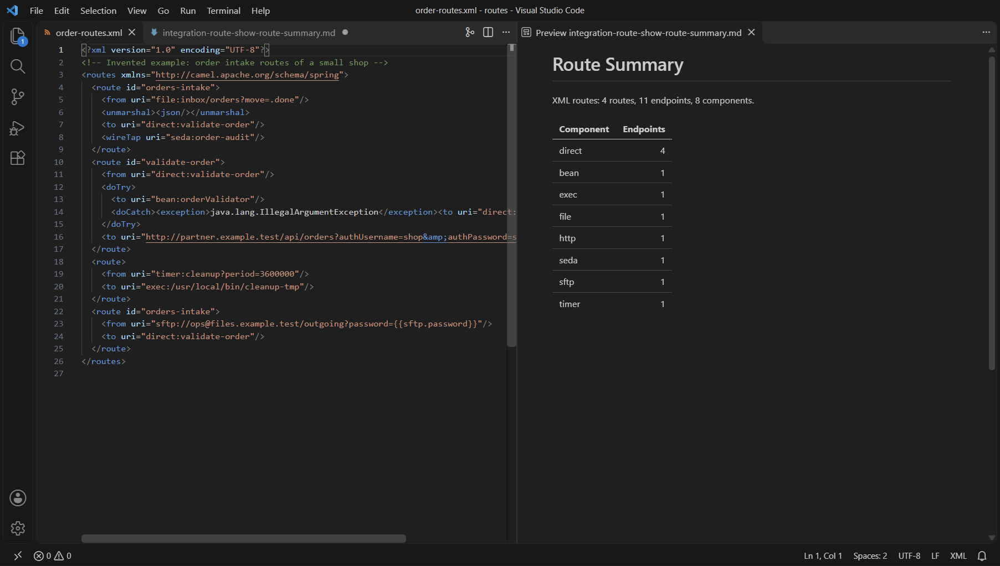
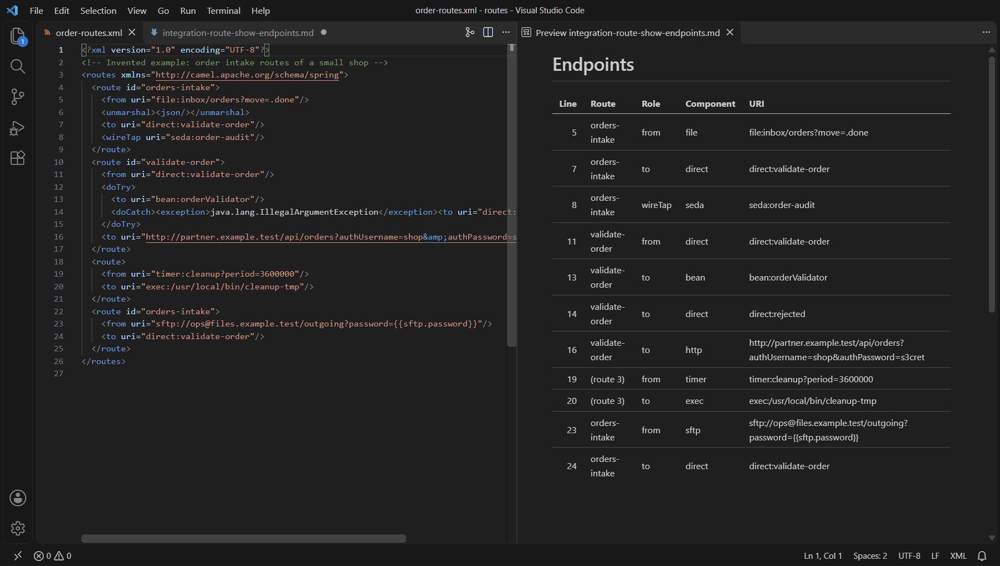
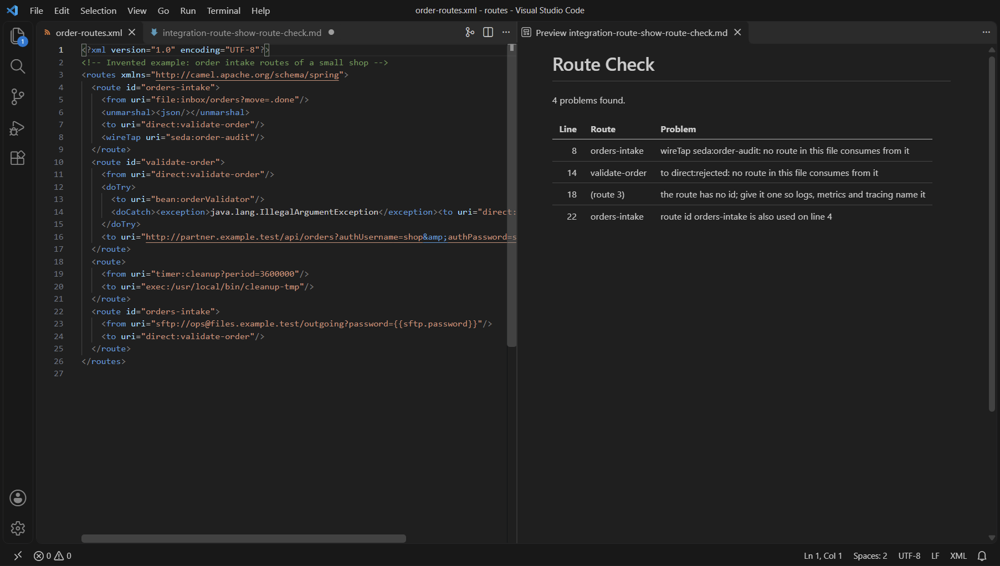
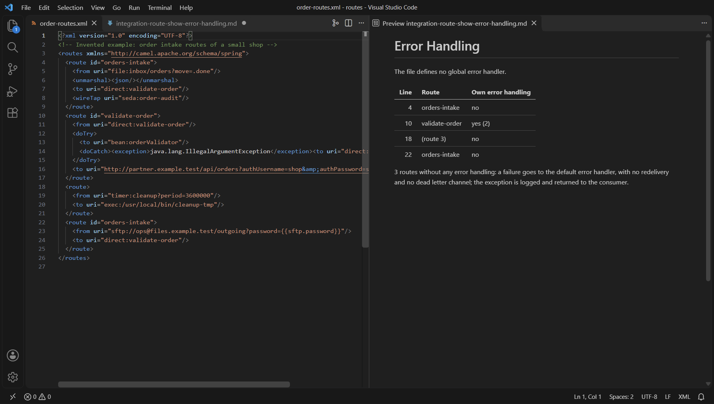
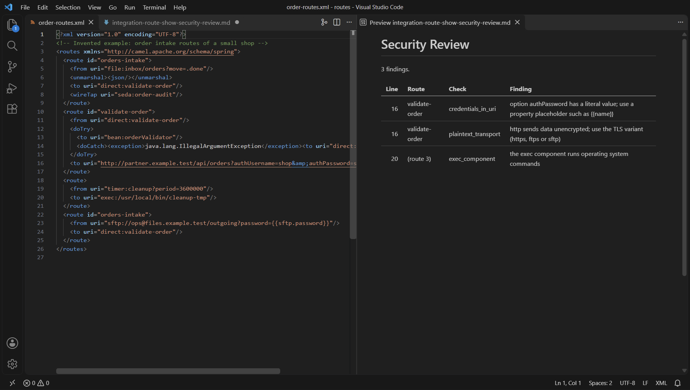

# Integration Route Atlas

Integration Route Atlas reads Apache Camel routes written in the XML DSL or the YAML DSL and turns them into clear Markdown reports: the routes, endpoints and components, every endpoint with its role and line, route problems such as missing or duplicate route ids and direct or seda endpoints that no route consumes, the routes without error handling, and security risks such as passwords written into endpoint URIs, unencrypted transports and the exec component.

Everything runs on your computer. There is no telemetry. The only network request the extension ever makes is the licence check for the optional Pro tier (see [Privacy](PRIVACY.md)).

## What it does

* **Show Route Summary**: The file at a glance: DSL, routes, endpoints and the components they use.
* **Show Endpoints**: Every endpoint with its line, route, role (from, to, toD, wireTap, enrich) and component.
* **Show Route Check**: Routes without or with duplicate ids, missing or extra from endpoints, empty URIs and direct or seda endpoints nobody consumes.
* **Show Error Handling** (Pro): Which routes have their own error handling, and what happens to the others.
* **Show Security Review** (Pro): Passwords and tokens written into URIs, unencrypted transports and the exec component.

## Free, trial and Pro

| Feature | Free | Pro |
| --- | :---: | :---: |
| Show Route Summary | yes | yes |
| Show Endpoints | yes | yes |
| Show Route Check | yes | yes |
| Show Error Handling |  | yes |
| Show Security Review |  | yes |
| Open Sample File, walkthrough, Report A Problem | yes | yes |

The free reports need no key, no account and no network connection, and they will not be moved behind the licence key later. The first Pro command starts a **free 14-day trial** on this computer. After that, Pro is a one-time purchase, not a subscription: **Pro Personal USD 19** (one person, use at work allowed) or **Pro Business USD 39 per user** (one key per user of an organisation). A key works on up to 3 computers. The checkout page shows the final price and any taxes for your country. Licence keys are sold by Dodo Payments, the merchant of record. Details: [licence](docs/licence.md), [terms](TERMS.md).

## Commands

Open the Command Palette and type `Integration Route Atlas`.

| Command | Tier |
| --- | :---: |
| Integration Route Atlas: Show Route Summary | Free |
| Integration Route Atlas: Show Endpoints | Free |
| Integration Route Atlas: Show Route Check | Free |
| Integration Route Atlas: Show Error Handling | Pro |
| Integration Route Atlas: Show Security Review | Pro |
| Integration Route Atlas: Open Sample File | Free |
| Integration Route Atlas: Open Walkthrough | Free |
| Integration Route Atlas: Show Documentation | Free |
| Integration Route Atlas: Report A Problem | Free |
| Integration Route Atlas: Buy Pro | Free |
| Integration Route Atlas: Enter Licence Key | Free |
| Integration Route Atlas: Show Licence Status | Free |
| Integration Route Atlas: Remove Licence From This Machine | Free |

## Settings

| Setting | Default | Meaning |
| --- | --- | --- |
| `integrationRouteAtlas.maxFileSizeMB` | 50 | Largest file a report reads (0.1 to 50 MB; VS Code passes files only up to 50 MB to extensions). |
| `integrationRouteAtlas.openReportsAsPreview` | true | Open each report in the Markdown preview as well. |

## FAQ

**Does Integration Route Atlas run my routes?**
No. It reads the route text in the editor; nothing is started, nothing is sent anywhere, and no Camel version is needed.

**Which DSLs are supported?**
The XML DSL (routes files, Spring and Blueprint camelContext, also with a camel: prefix) and the YAML DSL. Java DSL routes are not read.

**Why is a direct endpoint reported as not consumed?**
A to direct:x needs a route that starts from direct:x, or the exchange fails at run time. The check looks at the routes of the open file; routes in other files are not seen, and the report says so.

**How are credentials in URIs found?**
URI options whose name ends in password, secret, token, apiKey, accessKey or privateKey with a literal value are reported, as are user:password@ parts. Property placeholders such as {{name}} and RAW({{name}}) are fine.

## For IT and procurement

* Publisher: SmallStepsStudio (Visual Studio Marketplace), smallstepsstudio (Open VSX).
* Network: one host, `live.dodopayments.com`, for the licence check only, and only after a key is entered. No telemetry. The trial uses no network.
* Files are read from the editor only; the extension writes no files and changes none.
* Source: <https://github.com/small-steps-studio/integration-route-atlas>.
* Licence agreement: [LICENSE.txt](LICENSE.txt). Terms: [TERMS.md](TERMS.md). Privacy: [PRIVACY.md](PRIVACY.md).

## Support

Run **Integration Route Atlas: Report A Problem** or open an issue at <https://github.com/small-steps-studio/integration-route-atlas/issues>. Never post a licence key or confidential data in a public issue.

Apache Camel and Camel are trademarks of The Apache Software Foundation; Integration Route Atlas is an independent product and is not affiliated with or endorsed by The Apache Software Foundation.
